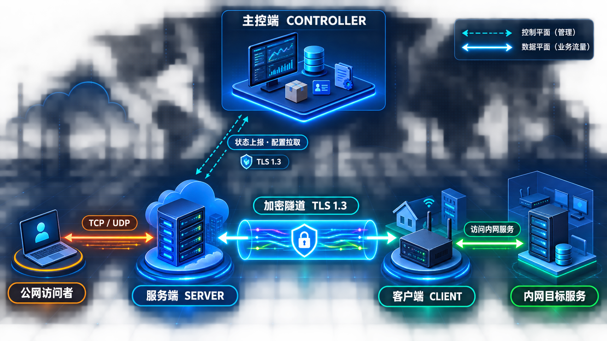

# Matrix Tunnel Proxy

[English](README.md) | [中文](README_CN.md)

Matrix Tunnel Proxy is a self-hosted TCP/UDP reverse-tunnel system with three programs:

- **Controller**: external web console, SQLite state, package provisioning and the TLS control endpoint.
- **Server**: runs on a public machine, reports status, polls Controller configuration, and owns public TCP/UDP listeners.
- **Client**: runs on an intranet machine, maintains a TLS tunnel to its bound Server and connects to local targets.

## How it works



Controller manages identities and configuration without relaying application traffic. Public TCP/UDP traffic enters through Server, crosses the encrypted TLS 1.3 tunnel to Client, and is then forwarded to the intranet target service.

## Project layout

```text
matrix-tunnel-proxy/
├── cmd/
│   ├── controller/        Controller entry point
│   ├── server/            public Server entry point and full-mapping support
│   └── client/            intranet Client entry point
├── internal/
│   ├── controller/        HTTP API, authentication, SQLite store and package builder
│   ├── identity/          sidecar JSON configuration handling
│   ├── pki/               internal CA, certificates and permanent device identities
│   └── protocol/          tunnel framing protocol
├── web/
│   ├── src/               React web console source
│   └── dist/              temporary production web build output
├── third_party/windivert/ Windows full-mapping DLL, driver and license
├── docs/                  architecture documentation
├── bin/
│   ├── web/dist/          web console copied here automatically by npm run build
│   └── ...                executables and runtime package assets
├── go.mod                 Go module and dependency versions
└── README_CN.md           Chinese documentation
```

The `data/` directory beside the Controller executable is generated at runtime and is not a build input. When Controller runs from `bin/`, this directory is `bin/data/`. It contains `controller.db` and the deployment-specific `pki/` directory. Do not include an existing runtime `data/` directory when preparing a fresh deployment.

## Download source and install dependencies

Requirements:

- Git, or a downloaded source archive.
- Go 1.23 or newer.
- Node.js `^20.19.0` or `>=22.12.0`, with npm.

Clone the repository:

```bash
git clone https://github.com/matrix-vk/matrix-tunnel-proxy.git
cd matrix-tunnel-proxy
```

This repository may include a complete ready-to-run `bin/` directory containing prebuilt programs and the matching console in `bin/web/dist/`. In that case, users who trust the published binaries can run Controller without installing Go or Node.js. On Linux and macOS, add execute permission after cloning or downloading if necessary:

```bash
chmod +x bin/controller-linux-amd64 bin/server-* bin/client-*
```

The complete `bin/` directory can be copied to a separate machine as the release package. Do not commit or distribute the generated `data/` directory beside Controller (`bin/data/` in the standard package).

Download Go dependencies and install the exact web dependency versions from `package-lock.json`:

```bash
go mod download
cd web
npm ci
cd ..
```

WinDivert is not downloaded by Go or npm. The repository release/source package must contain `third_party/windivert/x64/WinDivert.dll`, `WinDivert64.sys`, and `third_party/windivert/LICENSE.txt` to build self-contained Windows Server download packages with full mapping.

## Build and package

Build the web console first:

```bash
cd web
npm run build
cd ..
```

The intermediate result is written to `web/dist` and then copied automatically to `bin/web/dist`. The Controller executable and external web files remain separate, while the complete release stays inside `bin/`.

### Build all targets on Windows PowerShell

Run these commands from the project root:

```powershell
New-Item -ItemType Directory -Force bin | Out-Null

$targets = @(
  @{ Role = "controller"; OS = "windows"; Arch = "amd64"; Output = "controller.exe" },
  @{ Role = "controller"; OS = "linux";   Arch = "amd64"; Output = "controller-linux-amd64" },
  @{ Role = "server";     OS = "windows"; Arch = "amd64"; Output = "server.exe" },
  @{ Role = "server";     OS = "linux";   Arch = "amd64"; Output = "server-linux-amd64" },
  @{ Role = "server";     OS = "linux";   Arch = "arm64"; Output = "server-linux-arm64" },
  @{ Role = "server";     OS = "darwin";  Arch = "amd64"; Output = "server-darwin-amd64" },
  @{ Role = "server";     OS = "darwin";  Arch = "arm64"; Output = "server-darwin-arm64" },
  @{ Role = "client";     OS = "windows"; Arch = "amd64"; Output = "client.exe" },
  @{ Role = "client";     OS = "linux";   Arch = "amd64"; Output = "client-linux-amd64" },
  @{ Role = "client";     OS = "linux";   Arch = "arm64"; Output = "client-linux-arm64" },
  @{ Role = "client";     OS = "darwin";  Arch = "amd64"; Output = "client-darwin-amd64" },
  @{ Role = "client";     OS = "darwin";  Arch = "arm64"; Output = "client-darwin-arm64" }
)

foreach ($target in $targets) {
  $env:GOOS = $target.OS
  $env:GOARCH = $target.Arch
  go build -trimpath -o (Join-Path "bin" $target.Output) ("./cmd/" + $target.Role)
}
Remove-Item Env:GOOS
Remove-Item Env:GOARCH

Copy-Item third_party/windivert/x64/WinDivert.dll bin/
Copy-Item third_party/windivert/x64/WinDivert64.sys bin/
Copy-Item third_party/windivert/LICENSE.txt bin/WinDivert-LICENSE.txt
```

Run all Go tests before publishing:

```powershell
go test ./...
```

### Build all targets on Linux/macOS

```bash
mkdir -p bin
GOOS=windows GOARCH=amd64 go build -trimpath -o bin/controller.exe ./cmd/controller
GOOS=linux   GOARCH=amd64 go build -trimpath -o bin/controller-linux-amd64 ./cmd/controller

GOOS=windows GOARCH=amd64 go build -trimpath -o bin/server.exe ./cmd/server
GOOS=linux   GOARCH=amd64 go build -trimpath -o bin/server-linux-amd64 ./cmd/server
GOOS=linux   GOARCH=arm64 go build -trimpath -o bin/server-linux-arm64 ./cmd/server
GOOS=darwin  GOARCH=amd64 go build -trimpath -o bin/server-darwin-amd64 ./cmd/server
GOOS=darwin  GOARCH=arm64 go build -trimpath -o bin/server-darwin-arm64 ./cmd/server

GOOS=windows GOARCH=amd64 go build -trimpath -o bin/client.exe ./cmd/client
GOOS=linux   GOARCH=amd64 go build -trimpath -o bin/client-linux-amd64 ./cmd/client
GOOS=linux   GOARCH=arm64 go build -trimpath -o bin/client-linux-arm64 ./cmd/client
GOOS=darwin  GOARCH=amd64 go build -trimpath -o bin/client-darwin-amd64 ./cmd/client
GOOS=darwin  GOARCH=arm64 go build -trimpath -o bin/client-darwin-arm64 ./cmd/client

cp third_party/windivert/x64/WinDivert.dll bin/
cp third_party/windivert/x64/WinDivert64.sys bin/
cp third_party/windivert/LICENSE.txt bin/WinDivert-LICENSE.txt

go test ./...
```

For a release, publish only the complete `bin/` directory. Controller finds agent binaries beside its own executable, serves web assets from the adjacent `web/dist`, and creates runtime state in the adjacent `data` directory. In the standard package these paths are `bin/web/dist` and `bin/data`. Do not publish runtime `data`, Go caches, `web/node_modules`, the intermediate `web/dist`, or `web/.npm-cache`.

## Security model

Controller creates a unique random Token for every Server and Client. Controller stores only its SHA-256 hash. The Server presents an internally issued certificate, while Server and Client packages trust the embedded internal CA. Both Controller-to-Server and Server-to-Client links use TLS 1.3; Tokens authenticate the downloaded packages without requiring client certificates.

Client-to-Server tunnels send an application heartbeat every 15 seconds. A missing Pong closes the tunnel and the Client retries after 5 seconds. Tunnel sockets also enable TCP KeepAlive, and every framed write has a 15-second deadline so a half-open or back-pressured connection cannot block reconnect activity indefinitely. The Server closes a Client session after 45 seconds without incoming frames.

Server certificates are renewed by Controller before expiry and delivered over the authenticated configuration pull. Server swaps the certificate in memory while keeping the package's original private key, so a permanent Server record does not require annual package downloads.

## Start Controller

Build the web console first, then run Controller. The build copies the external web files to `bin/web/dist`, so the complete `bin` directory is self-contained for deployment.

```text
bin/controller.exe -listen :8080 -agent-listen :8443 -agent-url https://controller.example.com:8443
```

Open `http://localhost:8080`. Create a Server record, then use its separate Download button to select an operating system and obtain the bound package. Create Client records under that Server and download each package from the Client list. Extract each ZIP and keep its JSON file beside the executable. The agent locates that sidecar file from the executable directory, even when it is launched from another working directory.

On a fresh deployment, the web console guides you through two steps:

1. Initialize SQLite.
2. Set the site name and create the default super administrator.

The site name defaults to `Matrix Tunnel Proxy` and cannot be changed after initialization. The SQLite engine is compiled into Controller, so a separate `sqlite3` installation is not required. When the adjacent `data` directory is missing, Controller creates the database and `data/pki` automatically beside its executable.

Every record receives one permanent identity. Re-downloading the same Server or Client—on the same or another supported platform—reuses its original private key and Token, so existing packages remain valid. The Controller derives those credentials from its persistent CA key; SQLite continues to store only public keys and Token hashes. Back up the entire `data` directory beside Controller because replacing the Controller CA also replaces the root used to derive package identities.

Every downloaded ZIP is self-contained and bound to exactly one record:

- A Server package contains the platform executable and `server.json`. The JSON stores `serverId`, Controller agent endpoint, public tunnel endpoint, the unique Server Token, its private key and certificate, and the internal CA certificate. Windows packages also contain the official WinDivert x64 DLL, signed driver, and license for full mapping.
- A Client package contains the platform executable and `client.json`. The JSON stores `clientId`, its bound Server endpoint, the unique Client Token, and the internal CA certificate.

The public tunnel endpoint is the advertised address used by Clients and certificate verification. The Server takes only its port and listens on all local network interfaces; for example, `203.0.113.10:7000` produces a local listener on `:7000`, so the public IP does not need to be assigned to a local interface.

No manual connection setup is required. On Linux and macOS the ZIP marks the executable as `0755` and the identity JSON as `0600`. Treat the JSON files as secrets: copying one gives another process that identity until the corresponding record is deleted in Controller. Deleting the record revokes its Token and prevents future authentication.

For production, publish the web console through Nginx on the normal HTTPS port. The `agent-url` must point to the Controller TLS listener and must be reachable by the public Servers. Nginx may proxy this endpoint as ordinary HTTPS because Server authentication is carried by its bound Token.

### Controller listener configuration

Controller uses two listener ports by default. All addresses are configurable with command-line flags:

- `-listen`: web console and management API listen address; defaults to `:8080`.
- `-agent-listen`: TLS listen address used by Servers for status reports and configuration polling; defaults to `:8443`.
- `-agent-url`: public Controller endpoint embedded in Server packages. It must use HTTPS and be reachable by the public Servers.

Windows example:

```powershell
controller.exe `
  -listen :9080 `
  -agent-listen :9443 `
  -agent-url https://controller.example.com:9443
```

Linux example:

```bash
./controller-linux-amd64 \
  -listen :9080 \
  -agent-listen :9443 \
  -agent-url https://controller.example.com:9443
```

When only a local Nginx instance should reach the web console, bind the web listener to the loopback interface:

```powershell
controller.exe `
  -listen 127.0.0.1:9080 `
  -agent-listen :9443 `
  -agent-url https://controller.example.com:9443
```

Nginx can then reverse proxy external HTTPS requests to `127.0.0.1:9080`. The `agent-url` must be the HTTPS endpoint that Servers can actually reach; do not set it to a loopback-only address.

After changing `agent-url`, newly downloaded Server packages use the new endpoint. Already running Servers do not change their Controller address automatically and must be replaced with a newly downloaded package. Re-downloading still reuses the existing Server record's identity and Token.

## Users and permissions

- The default super administrator is created during initial setup. Its administrator role cannot be removed, and the account cannot be locked.
- New users are regular users by default.
- Regular administrators can see all business data but cannot access user management.
- Regular users can see and manage only their own Servers, Clients, mappings, and audit logs.
- Five consecutive failed login attempts lock an account for ten minutes. The super administrator can unlock it early.
- The super administrator can create users, change user passwords, lock or unlock accounts, and grant or revoke regular administrator access.

## Current package targets

- Controller: Windows x64 and Linux x64.
- Server and Client: Windows x64, Linux x64/ARM64, macOS Intel/Apple Silicon.

## Mapping API

TCP and UDP port mappings belong to a Server:

```text
GET  /api/v1/servers/{serverId}/mappings
POST /api/v1/servers/{serverId}/mappings
```

For a port mapping, the POST body uses `mappingType: "port"`, `clientId`, `protocol` (`tcp` or `udp`), `publicIp`, `publicPort`, `targetHost`, `targetPort`, and `priority`. For a full mapping, use `mappingType: "full"`, one specific `publicIp`, `targetHost`, optional `excludedPorts` such as `22,3389,8000-8010`, and `priority`; both TCP and UDP retain their original destination port on the Client side. TCP 22 (SSH) and 3389 (RDP) are always reserved by default to prevent a full mapping from cutting off server administration access.

For a given protocol, public IP, and port, the highest-priority mapping is marked `effective`; lower-priority mappings are marked `occupied`. A higher-priority port mapping can override one port inside a full mapping. A full mapping automatically reserves the Server tunnel's TCP port in addition to the configured reserved ports.

Full-mapping platform behavior:

- Linux Server: TCP+UDP full mapping prefers nftables TPROXY and policy routing, and automatically falls back to iptables TPROXY when an older kernel or nftables release lacks native support. Run as root and install `iproute2` plus at least one of `nft` or `iptables`.
- Windows Server: TCP+UDP full mapping through the bundled WinDivert driver. Run `server.exe` as Administrator when full mapping is enabled.
- macOS Server: TCP/UDP port mappings only. The web console disables full mapping after the Server platform is known.

Install the Linux full-mapping dependencies before starting Server.

Debian/Ubuntu (`apt`; the package is named `iproute2`):

```bash
sudo apt update
sudo apt install -y nftables iproute2
```

RHEL, Rocky Linux, AlmaLinux, Fedora, and newer CentOS (`dnf`; the package is usually named `iproute`):

```bash
sudo dnf install -y nftables iproute
```

Older CentOS/RHEL systems using `yum`:

```bash
sudo yum install -y nftables iproute
```

Verify both commands are available:

```bash
nft --version
ip -Version
```

Linux full mapping modifies nftables/iptables rules and policy routing at runtime, so run the Server as `root` or with equivalent network-administration capabilities. Full mapping uses conntrack direction to bypass return traffic for connections initiated by the Server, so it does not capture Controller configuration pulls, status reports, DNS, or other outbound connections. Removing or disabling a full mapping immediately removes its rules; SIGTERM/SIGINT also triggers cleanup before exit. On startup, the Server removes stale project-owned `mxp_`/`MXP_` rules left by an abnormal exit, so only one Matrix Proxy Server instance should run on a host.

Clients need no packet driver: Windows, Linux, and macOS Clients all receive full-mapping traffic through the same encrypted tunnel and connect to `targetHost` using the original destination port.

## License

Matrix Tunnel Proxy is released under the [MIT License](LICENSE).
