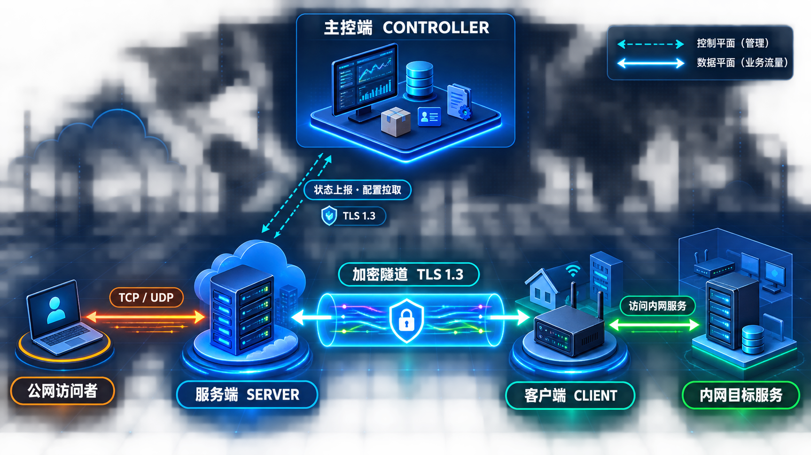

# Matrix Tunnel Proxy

[English](README.md) | [中文](README_CN.md)

Matrix Tunnel Proxy 是一个可自行部署的 TCP/UDP 内网穿透系统，由三个程序组成：

- **主控端（Controller）**：提供外置网页控制台、SQLite 数据存储、程序包生成和 TLS 控制端点。
- **服务端（Server）**：运行在公网服务器上，向主控端上报状态、定时拉取配置，并监听公网 TCP/UDP 端口。
- **客户端（Client）**：运行在内网机器上，与绑定的服务端保持 TLS 隧道连接，并连接内网目标服务。

## 工作原理



主控端负责身份与配置管理，不转发业务流量。公网 TCP/UDP 流量由服务端接入，经 TLS 1.3 加密隧道传送到客户端，再由客户端连接内网目标服务。

## 项目目录

```text
matrix-tunnel-proxy/
├── cmd/
│   ├── controller/        主控端程序入口
│   ├── server/            公网服务端入口和全映射实现
│   └── client/            内网客户端程序入口
├── internal/
│   ├── controller/        HTTP API、登录权限、SQLite 和程序包生成
│   ├── identity/          JSON 配置文件处理
│   ├── pki/               内部 CA、证书和永久设备身份
│   └── protocol/          隧道帧协议
├── web/
│   ├── src/               React 网页控制台源码
│   └── dist/              前端构建的临时生产输出
├── third_party/windivert/ Windows 全映射所需 DLL、驱动和许可证
├── docs/                  架构文档
├── bin/
│   ├── web/dist/          npm run build 自动复制到这里的网页文件
│   └── ...                可执行程序和运行时资源
├── go.mod                 Go 模块和依赖版本
└── README.md              英文文档
```

Controller 会在自身可执行文件所在目录下自动生成 `data/`，该目录不参与编译。从 `bin/` 启动时，对应路径就是 `bin/data/`。其中包含 `controller.db` 和本次部署独有的 `pki/`。准备全新部署包时，不要携带已有的运行数据目录。

## 下载源码和安装依赖

环境要求：

- Git，或者直接下载源码压缩包。
- Go 1.23 或更高版本。
- Node.js `^20.19.0` 或 `>=22.12.0`，并包含 npm。

克隆项目：

```bash
git clone https://github.com/matrix-vk/matrix-tunnel-proxy.git
cd matrix-tunnel-proxy
```

仓库可以直接包含完整的 `bin/`，其中包括预编译程序和与其匹配的 `bin/web/dist/` 网页文件。信任发布二进制文件的用户无须安装 Go 或 Node.js，即可直接运行 Controller。Linux 和 macOS 克隆或下载后，如果文件没有执行权限，需要先执行：

```bash
chmod +x bin/controller-linux-amd64 bin/server-* bin/client-*
```

发布时可以将整个 `bin/` 单独复制到其他机器。不要提交或分发 Controller 旁边运行后生成的 `data/`（标准目录结构下就是 `bin/data/`）。

下载 Go 依赖，并按照 `package-lock.json` 安装前端的固定依赖版本：

```bash
go mod download
cd web
npm ci
cd ..
```

WinDivert 不会由 Go 或 npm 自动下载。为了生成支持 Windows 全映射的完整服务端下载包，源码包或发布包必须包含 `third_party/windivert/x64/WinDivert.dll`、`WinDivert64.sys` 和 `third_party/windivert/LICENSE.txt`。

## 编译和打包

首先构建网页控制台：

```bash
cd web
npm run build
cd ..
```

前端首先生成到 `web/dist`，随后自动复制到 `bin/web/dist`。网页仍然位于 Controller 可执行程序外部，但完整发布内容都集中在 `bin/`。

### 在 Windows PowerShell 构建全部平台

在项目根目录执行：

```powershell
New-Item -ItemType Directory -Force bin | Out-Null

$targets = @(
  @{ Role = "controller"; OS = "windows"; Arch = "amd64"; Output = "controller.exe" },
  @{ Role = "controller"; OS = "linux";   Arch = "amd64"; Output = "controller-linux-amd64" },
  @{ Role = "server";     OS = "windows"; Arch = "amd64"; Output = "server.exe" },
  @{ Role = "server";     OS = "linux";   Arch = "amd64"; Output = "server-linux-amd64" },
  @{ Role = "server";     OS = "linux";   Arch = "arm64"; Output = "server-linux-arm64" },
  @{ Role = "server";     OS = "darwin";  Arch = "amd64"; Output = "server-darwin-amd64" },
  @{ Role = "server";     OS = "darwin";  Arch = "arm64"; Output = "server-darwin-arm64" },
  @{ Role = "client";     OS = "windows"; Arch = "amd64"; Output = "client.exe" },
  @{ Role = "client";     OS = "linux";   Arch = "amd64"; Output = "client-linux-amd64" },
  @{ Role = "client";     OS = "linux";   Arch = "arm64"; Output = "client-linux-arm64" },
  @{ Role = "client";     OS = "darwin";  Arch = "amd64"; Output = "client-darwin-amd64" },
  @{ Role = "client";     OS = "darwin";  Arch = "arm64"; Output = "client-darwin-arm64" }
)

foreach ($target in $targets) {
  $env:GOOS = $target.OS
  $env:GOARCH = $target.Arch
  go build -trimpath -o (Join-Path "bin" $target.Output) ("./cmd/" + $target.Role)
}
Remove-Item Env:GOOS
Remove-Item Env:GOARCH

Copy-Item third_party/windivert/x64/WinDivert.dll bin/
Copy-Item third_party/windivert/x64/WinDivert64.sys bin/
Copy-Item third_party/windivert/LICENSE.txt bin/WinDivert-LICENSE.txt
```

发布前执行全部 Go 测试：

```powershell
go test ./...
```

### 在 Linux/macOS 构建全部平台

```bash
mkdir -p bin
GOOS=windows GOARCH=amd64 go build -trimpath -o bin/controller.exe ./cmd/controller
GOOS=linux   GOARCH=amd64 go build -trimpath -o bin/controller-linux-amd64 ./cmd/controller

GOOS=windows GOARCH=amd64 go build -trimpath -o bin/server.exe ./cmd/server
GOOS=linux   GOARCH=amd64 go build -trimpath -o bin/server-linux-amd64 ./cmd/server
GOOS=linux   GOARCH=arm64 go build -trimpath -o bin/server-linux-arm64 ./cmd/server
GOOS=darwin  GOARCH=amd64 go build -trimpath -o bin/server-darwin-amd64 ./cmd/server
GOOS=darwin  GOARCH=arm64 go build -trimpath -o bin/server-darwin-arm64 ./cmd/server

GOOS=windows GOARCH=amd64 go build -trimpath -o bin/client.exe ./cmd/client
GOOS=linux   GOARCH=amd64 go build -trimpath -o bin/client-linux-amd64 ./cmd/client
GOOS=linux   GOARCH=arm64 go build -trimpath -o bin/client-linux-arm64 ./cmd/client
GOOS=darwin  GOARCH=amd64 go build -trimpath -o bin/client-darwin-amd64 ./cmd/client
GOOS=darwin  GOARCH=arm64 go build -trimpath -o bin/client-darwin-arm64 ./cmd/client

cp third_party/windivert/x64/WinDivert.dll bin/
cp third_party/windivert/x64/WinDivert64.sys bin/
cp third_party/windivert/LICENSE.txt bin/WinDivert-LICENSE.txt

go test ./...
```

发布时只需要完整的 `bin/`。Controller 会从自身目录查找服务端、客户端程序，从旁边的 `web/dist` 提供外置网页，并把运行数据写入旁边的 `data` 目录；在标准目录结构下，这两个路径分别是 `bin/web/dist` 和 `bin/data`。不要发布运行数据目录、Go 缓存、`web/node_modules`、中间目录 `web/dist` 或 `web/.npm-cache`。

## 安全模型

主控端为每条服务端和客户端记录生成唯一 Token，SQLite 只保存 Token 的 SHA-256 哈希。服务端使用内部 CA 签发的证书，服务端和客户端程序包信任包内的内部 CA 证书。主控端到服务端、服务端到客户端的连接均使用 TLS 1.3；下载包通过 Token 验证身份，不要求客户端证书。

客户端到服务端的隧道每 15 秒发送一次应用层心跳。收不到 Pong 时会关闭隧道，客户端在 5 秒后重新连接。隧道套接字还会显式启用 TCP KeepAlive，并为每次协议帧写入设置 15 秒超时，避免半断开或对端阻塞导致重连逻辑永久卡住。服务端连续 45 秒收不到任何客户端协议帧时会关闭该会话。

主控端会在服务端证书到期前自动续签，并通过经过身份验证的配置拉取接口下发。服务端在内存中更新证书，同时继续使用程序包原来的私钥，因此永久服务端记录不需要每年重新下载程序包。

每个全新部署都会使用系统安全随机源生成独立的 PKI。不同部署不应复制同一份 Controller 旁边的 `data/pki`，否则会共享相同的根身份。系统迁移或灾备恢复时，应当将整个 `data` 目录一起备份和恢复。

## 启动主控端

先构建网页控制台，再启动主控端。构建过程会把外置网页复制到 `bin/web/dist`，完整的 `bin` 目录可以独立部署。

```text
bin/controller.exe -listen :8080 -agent-listen :8443 -agent-url https://controller.example.com:8443
```

打开 `http://localhost:8080`。全新部署会按顺序显示：

1. 初始化 SQLite。
2. 设置网站名称并创建默认超级管理员。

网站名称默认是 `Matrix Tunnel Proxy`，初始化完成后不提供修改入口。SQLite 引擎已经编译进 Controller，不需要额外安装 `sqlite3`。缺少旁边的 `data` 目录时，Controller 会在自身目录下自动创建数据库和 `data/pki`。

创建服务端记录后，通过单独的“下载”按钮选择操作系统并获取绑定程序包。在该服务端下创建客户端记录，再从客户端列表下载各自的程序包。解压 ZIP 后，必须将 JSON 配置文件与可执行程序放在同一目录；即使从其他工作目录启动，程序也会从可执行程序所在目录读取配置。

每条记录拥有永久身份。对同一条服务端或客户端记录重复下载时，无论平台是否变化，都会复用原来的私钥和 Token，已经运行的旧程序包不会因此失效。主控端根据持久化 CA 私钥派生这些凭据，SQLite 只保存公钥和 Token 哈希。

每个下载的 ZIP 都是独立程序包，并且只绑定一条记录：

- 服务端程序包包含对应平台的可执行程序和 `server.json`。JSON 保存 `serverId`、主控端 Agent 地址、公网隧道端点、服务端 Token、私钥、证书和内部 CA 证书。Windows 包还包含全映射所需的官方 WinDivert x64 DLL、签名驱动和许可证。
- 客户端程序包包含对应平台的可执行程序和 `client.json`。JSON 保存 `clientId`、绑定的服务端地址、客户端 Token 和内部 CA 证书。

“公网隧道端点”是提供给客户端连接及证书校验的对外地址。服务端程序只取该端点的端口，并在本机所有网络接口上监听；例如填写 `203.0.113.10:7000` 时，本地实际监听 `:7000`，无需将公网 IP 配置到本机网卡上。

无需手工填写连接配置。Linux 和 macOS ZIP 中的可执行文件权限为 `0755`，身份 JSON 权限为 `0600`。JSON 文件属于敏感文件：复制 JSON 相当于复制该设备身份，直到在主控端删除对应记录并撤销 Token。

生产环境建议通过 Nginx 的标准 HTTPS 端口发布网页控制台。`agent-url` 必须指向主控端的 TLS Agent 端点，并且能够被公网服务端访问。Nginx 可以将该端点作为普通 HTTPS 请求反向代理，服务端身份仍由绑定 Token 验证。

### Controller 监听端口配置

Controller 默认使用两个监听端口，均可通过启动参数修改：

- `-listen`：网页控制台和管理 API 的监听地址，默认 `:8080`。
- `-agent-listen`：服务端上报状态、拉取配置所使用的 TLS 监听地址，默认 `:8443`。
- `-agent-url`：写入服务端程序包的主控端公网地址，必须使用 HTTPS，并且需要能被公网服务端访问。

Windows 示例：

```powershell
controller.exe `
  -listen :9080 `
  -agent-listen :9443 `
  -agent-url https://controller.example.com:9443
```

Linux 示例：

```bash
./controller-linux-amd64 \
  -listen :9080 \
  -agent-listen :9443 \
  -agent-url https://controller.example.com:9443
```

如果网页控制台只允许同一台机器上的 Nginx 访问，可以仅监听本机回环地址：

```powershell
controller.exe `
  -listen 127.0.0.1:9080 `
  -agent-listen :9443 `
  -agent-url https://controller.example.com:9443
```

此时可以由 Nginx 将外部 HTTPS 请求反向代理到 `127.0.0.1:9080`。`agent-url` 必须填写服务端实际能够访问的 HTTPS 地址，不能填写仅本机可访问的地址。

修改 `agent-url` 后，新下载的服务端程序包会使用新地址。已经运行的旧服务端不会自动更换主控端地址，需要重新下载并替换程序包；重复下载仍沿用原服务端记录的身份和 Token。

## 用户与权限

- 默认超级管理员在首次初始化时创建，不能取消管理员身份，也不能被锁定。
- 新用户默认是普通用户。
- 普通管理员可以查看全部业务数据，但不能进入用户管理。
- 普通用户只能查看和管理自己名下的服务端、客户端、映射和审计日志。
- 连续登录错误 5 次后，账号锁定 10 分钟；超级管理员可以提前解除锁定。
- 超级管理员可以创建用户、修改用户密码、锁定或解除锁定用户，以及设置或取消普通管理员身份。

## 当前程序包平台

- 主控端：Windows x64、Linux x64。
- 服务端和客户端：Windows x64、Linux x64/ARM64、macOS Intel/Apple Silicon。

## 映射 API

TCP 和 UDP 端口映射属于某个服务端：

```text
GET  /api/v1/servers/{serverId}/mappings
POST /api/v1/servers/{serverId}/mappings
PATCH /api/v1/servers/{serverId}/mappings/{mappingId}
```

端口映射的 POST 请求使用 `mappingType: "port"`，并包含 `clientId`、`protocol`（`tcp` 或 `udp`）、`publicIp`、`publicPort`、`targetHost`、`targetPort` 和 `priority`。

全映射使用 `mappingType: "full"`、一个明确的 `publicIp`、`targetHost`、可选的 `excludedPorts`（例如 `22,3389,8000-8010`）以及 `priority`。TCP 和 UDP 都会在客户端一侧保留原始目标端口。TCP 22（SSH）和 3389（远程桌面）始终默认保留，防止启用全映射后失去服务器管理连接。

每条映射默认公开访问。可以在映射列表点击“防火墙”，继续公开访问，或使用 IP 白名单限制来源。白名单支持单个 IPv4/IPv6 地址和 CIDR 网段，例如 `203.0.113.10,198.51.100.0/24,2001:db8::/32`。对应 PATCH 请求使用 `accessMode: "public"`，或使用 `accessMode: "allowlist"` 并传入 `allowedIps`。

对于相同协议、公网 IP 和端口，优先级最高的映射标记为 `effective`，较低优先级映射标记为 `occupied`。高优先级端口映射可以覆盖全映射中的单个端口。全映射会自动保留服务端隧道 TCP 端口以及手工配置的保留端口。

各平台全映射行为：

- Linux 服务端：优先通过 nftables TPROXY 和策略路由实现 TCP+UDP 全映射；旧版内核或 nftables 不支持原生 TPROXY 时自动回退到 iptables TPROXY。需要使用 root 运行，并安装 `iproute2`，以及 `nft` 或 `iptables` 中的至少一个。
- Windows 服务端：通过程序包内的 WinDivert 驱动实现 TCP+UDP 全映射。启用全映射时需要以管理员身份运行 `server.exe`。
- macOS 服务端：仅支持 TCP/UDP 端口映射。主控端识别平台后，网页控制台会禁用全映射选项。

运行 Linux 服务端全映射前，需要先安装相关依赖。

Debian/Ubuntu 使用 `apt`，软件包名为 `iproute2`：

```bash
sudo apt update
sudo apt install -y nftables iproute2
```

RHEL、Rocky Linux、AlmaLinux、Fedora 和较新的 CentOS 使用 `dnf`。这类系统的软件包名通常是 `iproute`，不是 `iproute2`：

```bash
sudo dnf install -y nftables iproute
```

使用 `yum` 的旧版 CentOS/RHEL：

```bash
sudo yum install -y nftables iproute
```

安装后可以检查两个命令是否可用：

```bash
nft --version
ip -Version
```

Linux 全映射会在运行时修改 nftables/iptables 规则和策略路由，因此需要使用 `root` 运行服务端，或者授予等效的网络管理权限。全映射会根据连接跟踪方向放行本机主动连接的返回流量，因此不会截获服务端向 Controller 发起的配置拉取、状态上报以及 DNS 等出站连接。删除或停用全映射时，服务端会立即移除对应规则；收到 SIGTERM/SIGINT 时也会先清理规则再退出。服务端启动时会清理本项目前次异常退出遗留的 `mxp_`/`MXP_` 规则，因此同一台主机应只运行一个 Matrix Proxy Server 实例。

客户端不需要安装数据包驱动。Windows、Linux 和 macOS 客户端都通过同一条加密隧道接收全映射流量，并使用原始目标端口连接 `targetHost`。

## 开源许可

Matrix Tunnel Proxy 使用 [MIT License](LICENSE) 开源许可。
